<div align="center">
<h1 align="center">&nbsp;短剧盒 · ShortDramaBox</h1>

### 专注短剧的桌面播放器

**小体积 · 免安装 · 免登录 · 零广告 · 跨平台 · 跨设备 · 满配体验 · 为刷剧而生**

<p>


</p>
<br>
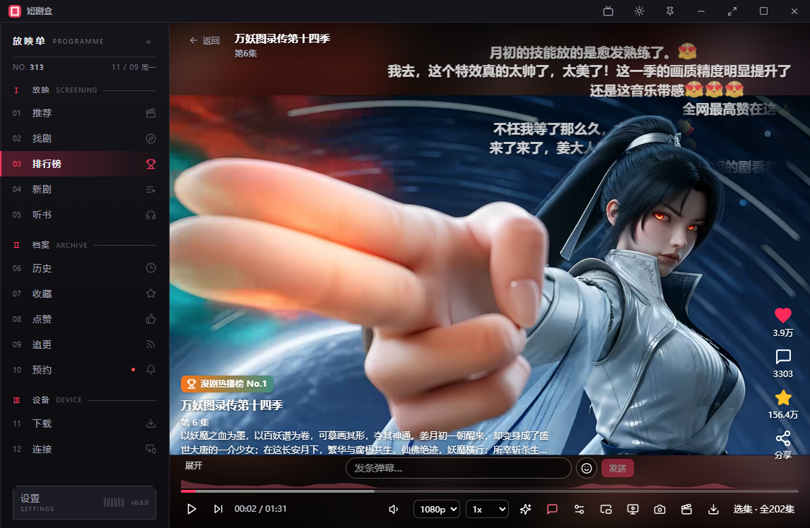

<br>

### 立即下载

<p>
<a href="https://github.com/kiroswu/hongguo-shortdramabox/releases/latest"></a>
<a href="https://gitee.com/kiroswu/hongguo-shortdramabox/releases/"></a>
<a href="https://share.feijipan.com/s/iYzFFXqV"></a>
</p>

Windows · macOS · Linux 全平台，免安装，双击即用

<p><sub><a href="https://github.com/kiroswu/hongguo-shortdramabox/releases/latest">GitHub Releases</a> · <a href="https://gitee.com/kiroswu/hongguo-shortdramabox/releases/">Gitee Releases</a> · <a href="https://share.feijipan.com/s/iYzFFXqV">网盘直下</a></sub></p>

</div>

##  一、产品亮点

| 亮点 | 说明 |
| :---: | :--- |
|  **极速稳定** | 秒开即播，即点即看；硬件解码加持，资源占用低，长时间刷剧依旧流畅 |
|  **小巧精悍** | 软件包仅约 6MB，体积做到极致，核心功能毫不缩水 |
|  **免登录** | 无需登录、全功能畅享、记录全存在本地；支持账号登录，数据自动同步云端 |
|  **免安装** | 绿色单文件，双击即可运行；删除即卸载，不留任何残留 |
|  **零广告** | 无广告、无贴片、无弹窗，追剧过程不被打断 |
|  **跨平台** | Windows / macOS / Linux 全平台覆盖，一致体验 |
|  **跨设备** | **蜂巢服务覆盖局域网内所有设备**，TV电视、电脑、平板和手机无需额外下载和适配，连接无上限 |

## 二、功能特性

一句话看懂：**找剧 → 看剧 → 追剧 → 存剧 → 全家共享**，全部装在同一个窗口里。

| 模块 | 能做什么 |
| :--- | :--- |
| **找剧** | 全网聚合搜索、热播榜/新剧榜、推荐/漫剧/真人剧多频道 |
| **看剧** | 1080P 多档画质（超分可达 4K）、即点即播、断点续播、最高 3x 倍速、自动连播、弹幕开关 |
| **追剧** | 历史/收藏/点赞/追更/预约，免登录、全存本地；登录账号后自动云同步 |
| **存剧** | 整剧批量下载为 MP4，一键合并成单个视频，离线随时刷 |
| **共享** | 蜂巢服务：局域网内电视/平板/手机打开浏览器就能看，无需装 App、设备数量无上限 |
| **进阶** | 画质/音效增强、智能变速、AI 景深弹幕、跳过「上集回顾」、高能热力条、截图剪辑、小窗与摸鱼模式 |

<details>
<summary><b>展开查看完整功能清单</b></summary>

**播放** — 多档画质与 4K 超分；自动记忆进度，下次打开无缝续播；内置弹幕引擎，一键开关且切集留存；多档倍速自由切换（最高 3x）；看完当前集自动接下一集/季；置顶小窗播放并自动切换为无边框模式；摸鱼模式一键伪装，配全局快捷键随时唤起或隐藏。

**发现** — 聚合搜索，热门短剧一网打尽；热播榜、新剧榜实时更新；推荐、漫剧、真人剧等频道浏览。

**管理** — 历史、收藏、点赞、追更、预约全存本地，隐私无忧；一键追更掌握更新动态；提前预约新剧开播；支持短信/扫码登录账号，数据自动同步云端。

**下载** — 剧集一键下载为本地 MP4；整部剧批量缓存，下载任务统一管理；多集一键合并为单个视频。

**体验** — 关窗自动收缩至系统托盘，播放不中断、随时一键唤回；画质、倍速、弹幕、窗口位置与尺寸等偏好自动记忆；深/浅主题切换，主题色与毛玻璃材质、窗体倍率缩放；移动端访问蜂巢服务网页自动适配，支持触摸控制。

**高级** — 蜂巢服务一键服务化，局域网内所有设备全功能共享看剧、互不干扰；无头基站「短剧猫」可跑在 NAS/云主机上，提供不间断服务；播放胶囊自动留存进行中的视频，支持拖拽分离、边找边看；画质锐化、超分、精度及亮度/对比度/饱和度/色温调节；人声、低音、影院、夜间四种音效预设与强度调节；智能识别并跳过每集开头的「上集回顾」；进度条叠加高能热力曲线；AI 景深弹幕按画面景深分层渲染、主体不被遮挡、全程本地推理；一键截图，自选片段导出 GIF 或 MP4。

</details>

## 三、界面预览
### 客户端界面
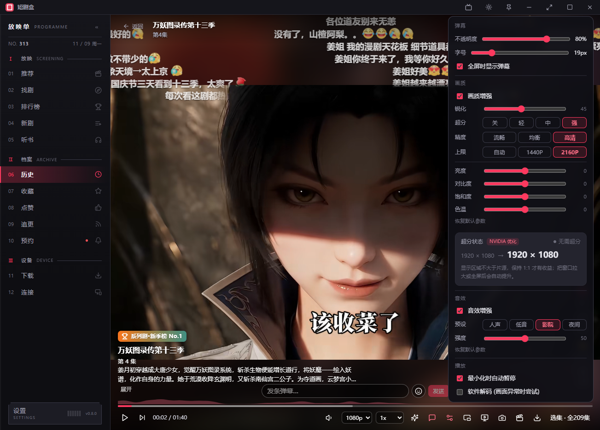
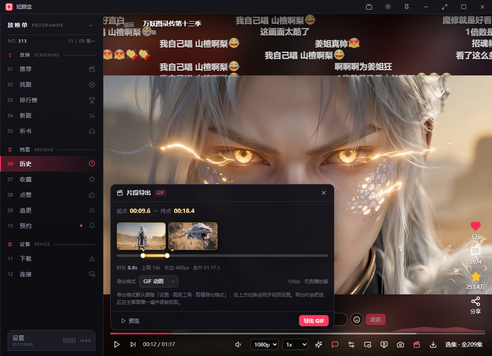
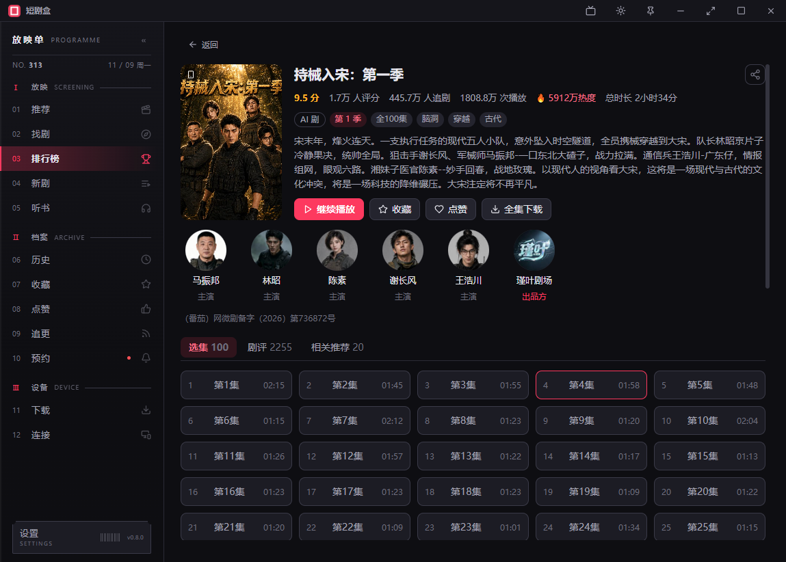
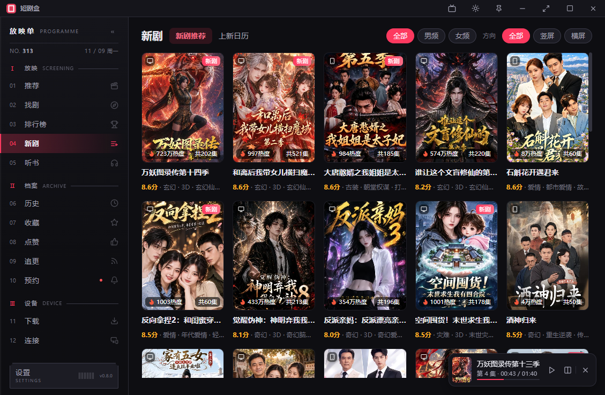
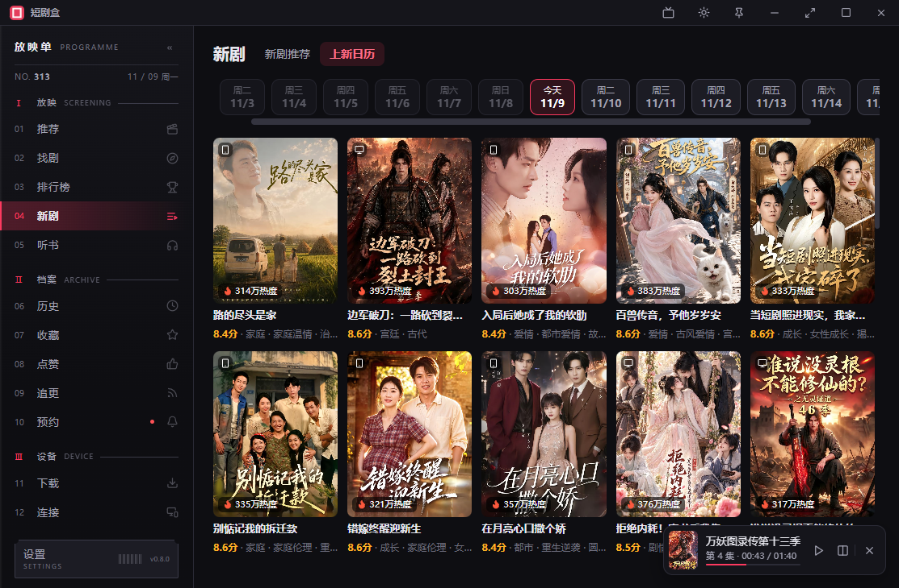
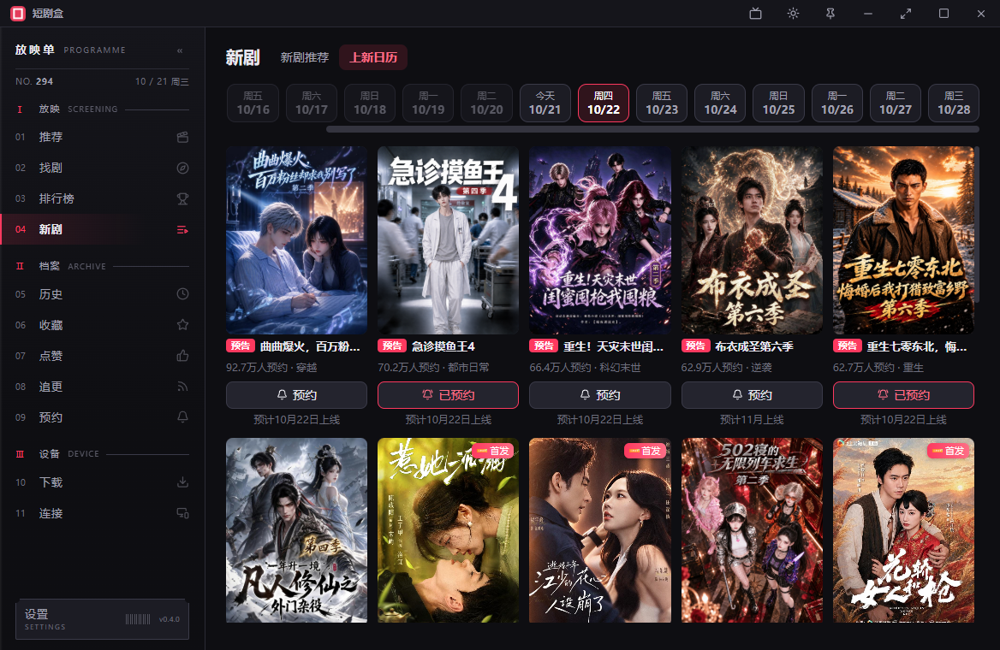
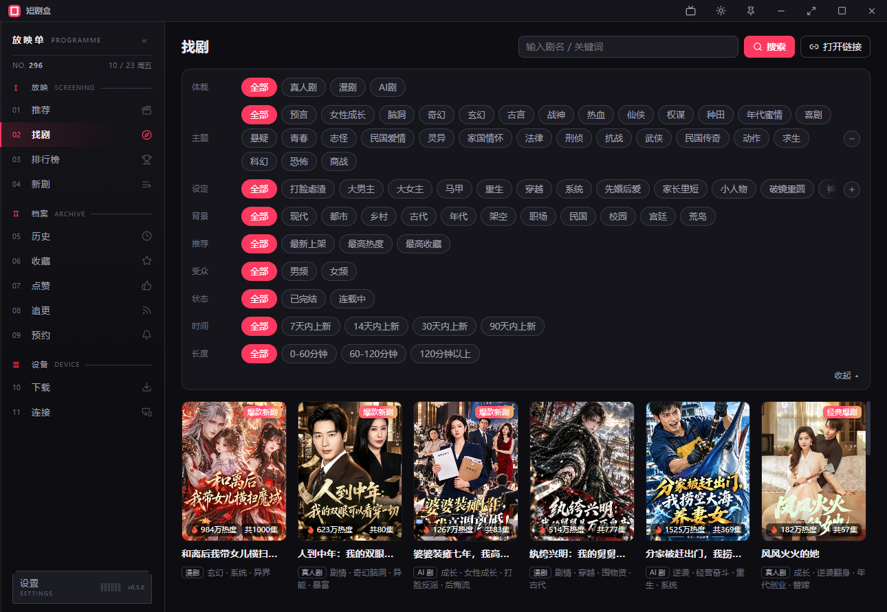
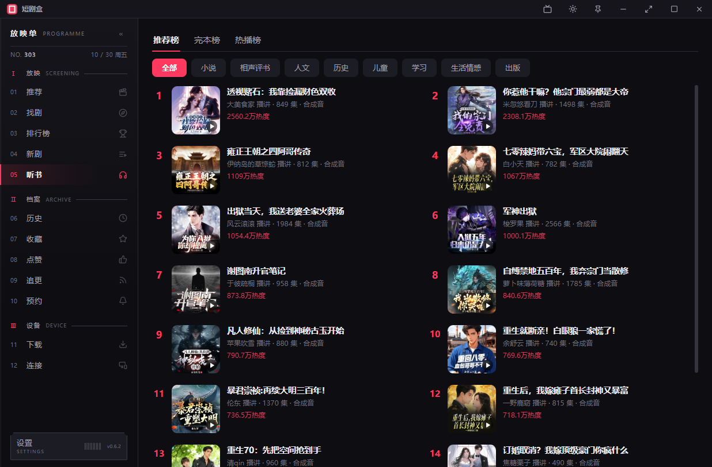
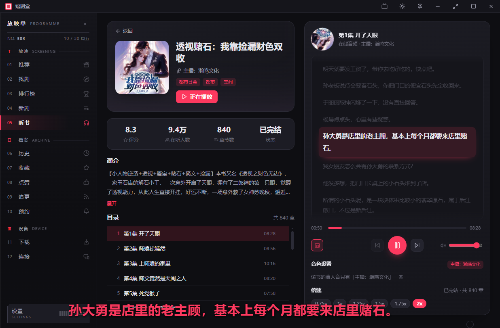
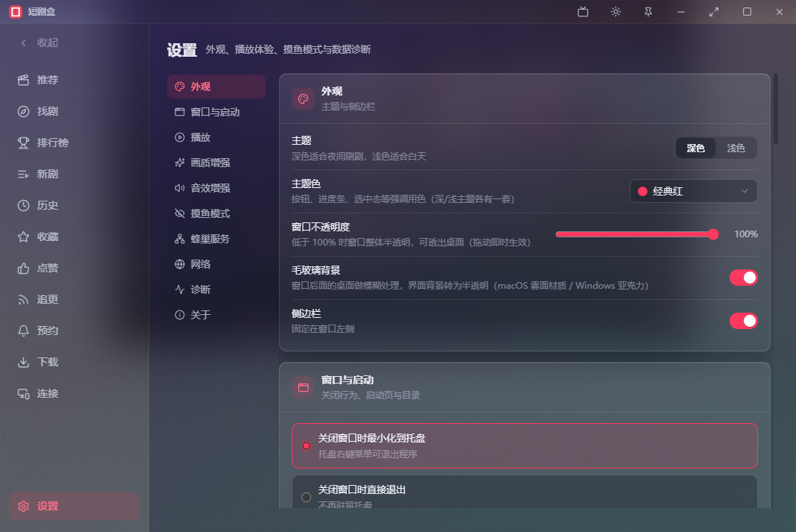

### 蜂巢移动端界面
| 推荐 | 找剧 |
|---|---|
| 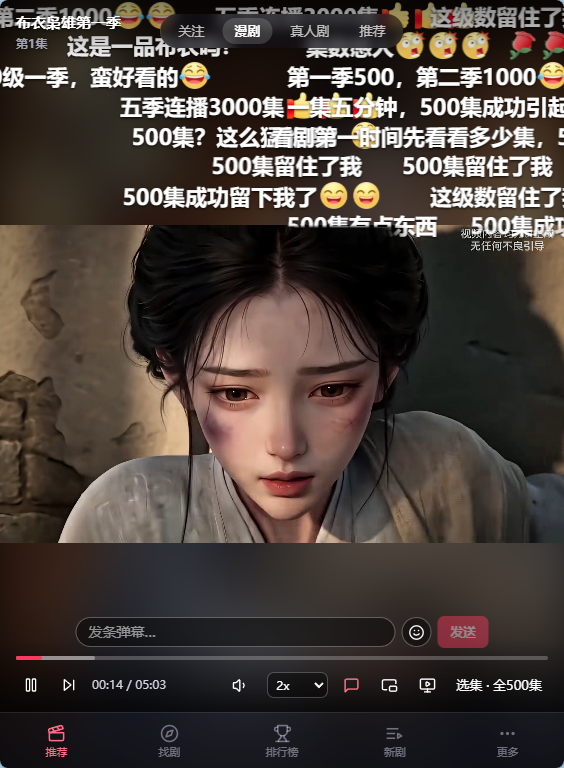 | 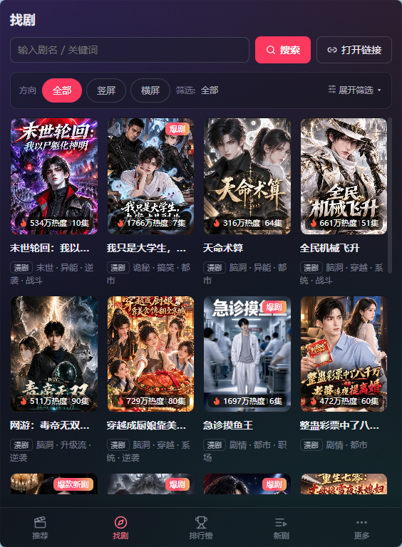 |
| **排行榜** | **新剧** |
| 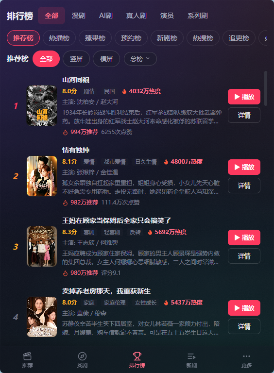 |  |
| **详情** | **设置** |
| 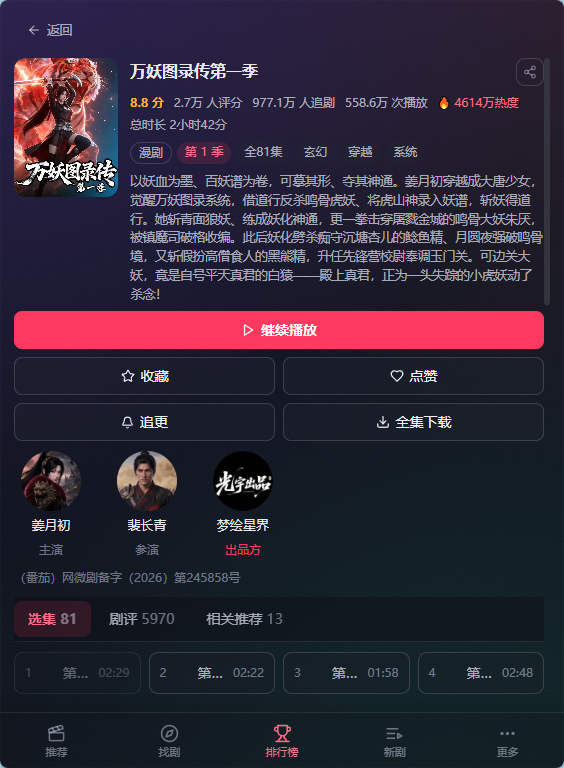 | 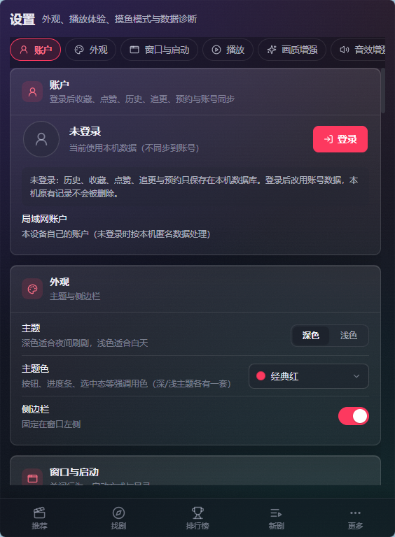 |


## 四、下载与运行

**不想折腾，直接走网盘**（免登录、无提取码、点开即下）：

> **网盘地址：[https://share.feijipan.com/s/iYzFFXqV](https://share.feijipan.com/s/iYzFFXqV)**

需要全部版本（含 Linux 服务端与历史版本）时，请前往仓库 **Releases** 页面：

| 平台 | 系统要求 | 下载地址 |
| :--- | :--- | :--- |
|  Windows | Windows 10/11 x86/ARM | [GitHub Releases](../../releases/latest) |
|  MacOS | Intel 芯片/Apple Silicon | [GitHub Releases](../../releases/latest) |
| Linux | 主流桌面发行版 x86/ARM | [GitHub Releases](../../releases/latest) |
| Headless主机 | 主机 / NAS / 云服务器 / 容器等无界面版Linux | [GitHub Releases](../../releases/latest) |

> **国内用户**建议访问 Gitee 仓库的 [Releases](https://gitee.com/kiroswu/hongguo-shortdramabox/releases/) 页面下载，速度更快。下载后双击即可运行，无需安装；删除文件夹即完成卸载。

Linux版本如何选？

| 差异性 | ShortDramaBox短剧盒Linux版| ShortDramaCat短剧猫Linux版|
| :---: | :--- | :--- |
|软体形态|AppImage单文件|二进制可执行文件|
|运行平台|仅限有图形界面的桌面发行版Linux|任意Linux，包括Headless Linux|
|使用方式|双击运行|命令行运行/管理|
|环境要求|需额外安装依赖包|无需安装依赖包|
|场景|客户端与Windows/MacOS一致，集成蜂巢服务功能|服务化后台运行，只能局域网浏览器访问|
|获取方式|ShortDramaBox开头，AppImage后缀|ShortDramaCat开头，无后缀|

Linux桌面版用户运行AppImage需先安装依赖包：
```shell
# Ubuntu 22.04 / Debian 12
sudo apt update
sudo apt install -y libwebkit2gtk-4.1-0 libayatana-appindicator3-1 \
  gstreamer1.0-libav gstreamer1.0-plugins-good gstreamer1.0-gl libfuse2

# Ubuntu 24.04+（t64 迁移后 FUSE2 的包名变了，其余相同）
sudo apt install -y libwebkit2gtk-4.1-0 libayatana-appindicator3-1 \
  gstreamer1.0-libav gstreamer1.0-plugins-good gstreamer1.0-gl libfuse2t64

# 赋权及图标
chmod +x ShortDramaBox_vx.x.x_amd64|aarch64.AppImage
./ShortDramaBox_vx.x.x_amd64|aarch64.AppImage --install
# 双击启动
```

## 五、常见问题

**Q1：只有声音、但是没有画面**
需要本机安装**HEVC视频扩展**对H.265解码（推荐。[点击下载](https://github.com/kiroswu/hongguo-shortdramabox/releases#release-HEVC%E8%A7%86%E9%A2%91%E6%89%A9%E5%B1%95)），或者在软件设置中开启**软件解码**。

**Q2：使用短剧盒需要安装吗？**
不需要。软件为绿色单文件程序，下载后直接运行即可，删除目录即彻底卸载，无任何残留。

**Q3：观看记录、收藏等数据会上传吗？**
未登录时历史、收藏、点赞、追更、预约等数据全部保存在本地；登录账号后数据自动同步到官方云端。软件本身不收集、不上传任何个人数据。

**Q4：播放卡顿如何处理？**
软件默认启用硬件解码。如遇有声音没画面或兼容性问题，可在设置中切换解码方式，或适当降低播放画质。

**Q5：短剧盒会开源完整源代码吗？**
完整源代码的开源正在考虑中，确定后将第一时间在本仓库公布，敬请期待。

## 六、免责声明

> 本项目为个人开源学习项目，**仅供学习与技术交流使用，严禁用于任何商业用途**。
> 软件本身不存储、不上传、不分发任何视频内容；所有内容均来源于网络公开接口，版权归原作者及原平台所有。
> 请于下载后 24 小时内删除本软件，并建议前往正规视频平台观看，支持创作者与正版内容。
> 如本项目内容涉及侵权，请联系作者处理，我们将第一时间配合删除。

---
<div align="center">

**如果 短剧盒 对你有帮助，欢迎点亮 Star 支持本项目！**

</div>
