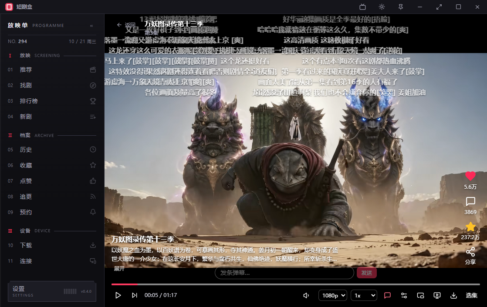
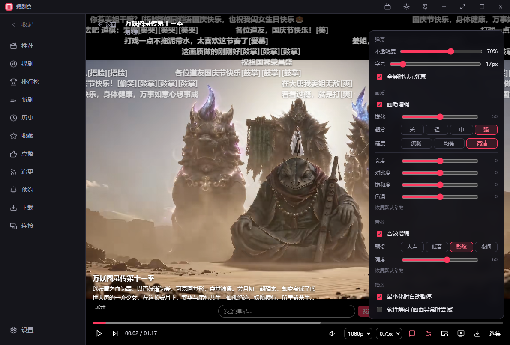
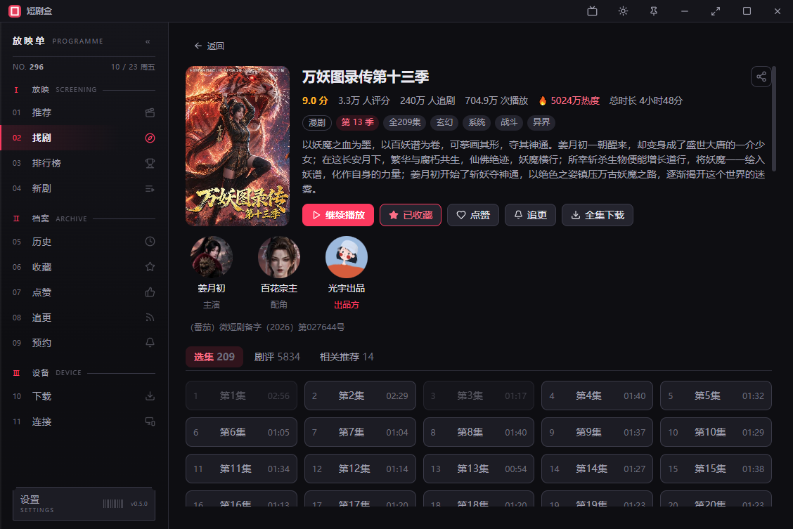
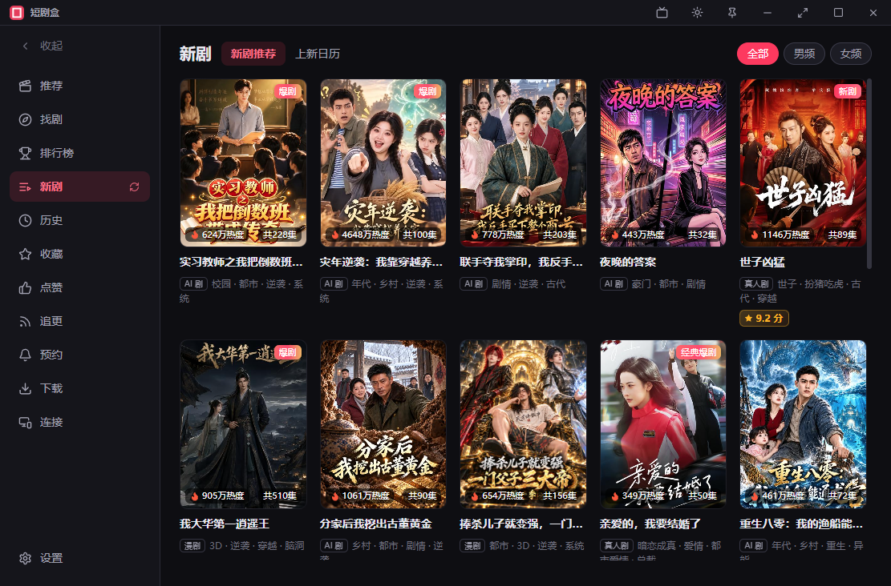
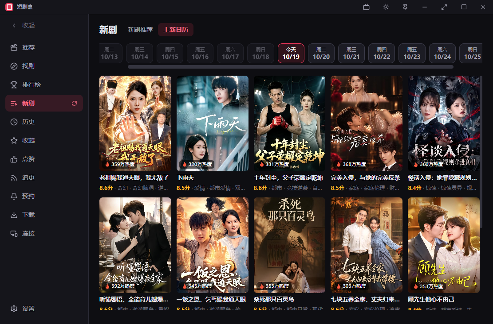
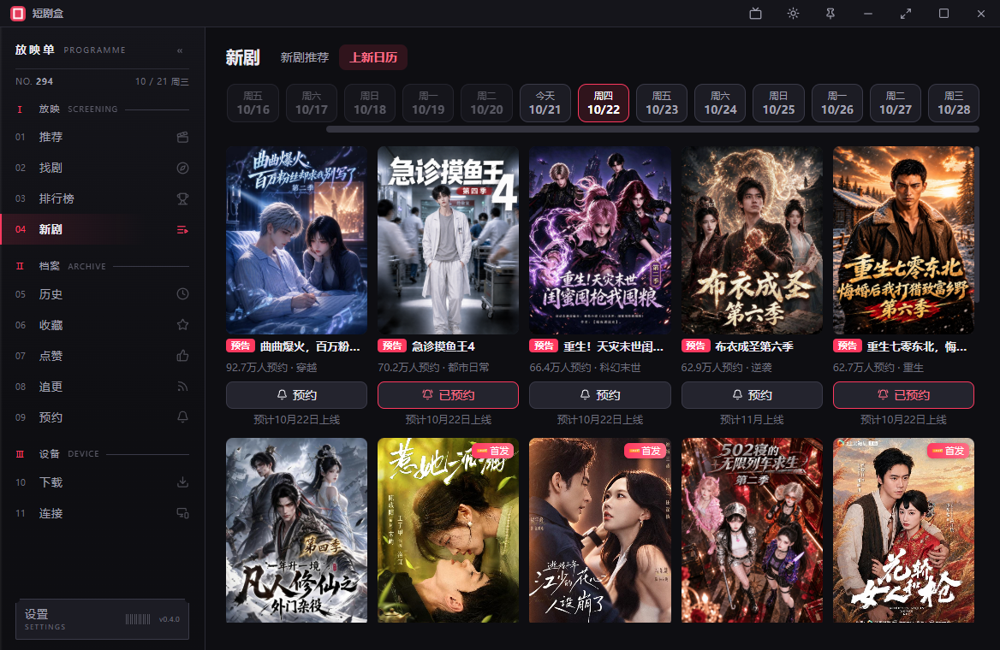
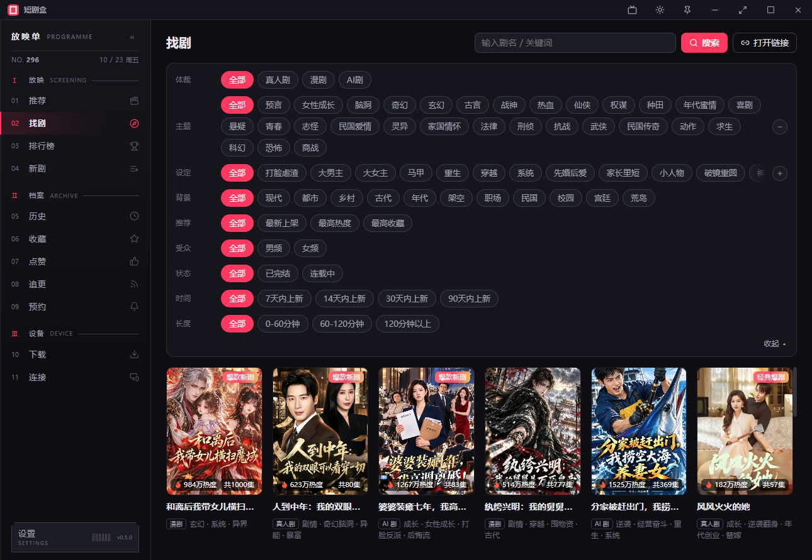
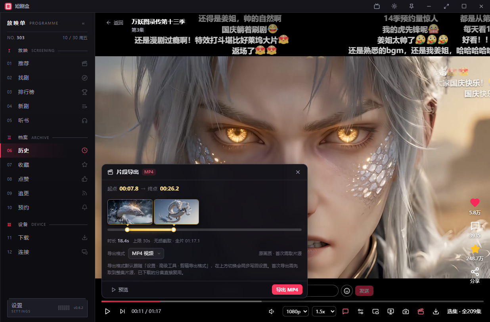
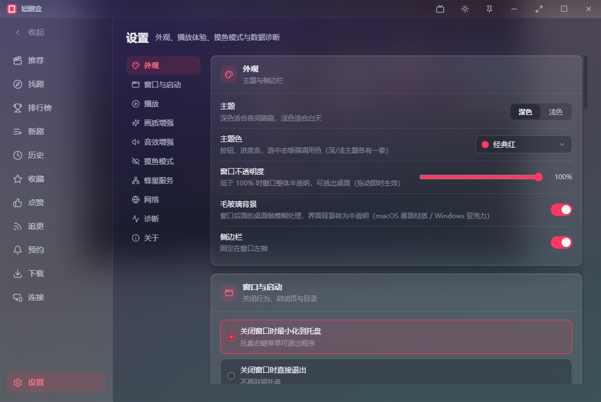

<div align="center">
<h1 align="center">&nbsp;短剧盒 · ShortDramaBox</h1>

### 专注短剧的桌面播放器

**小体积 · 免安装 · 免登录 · 零广告 · 跨平台 · 跨设备 · 满配体验 · 为刷剧而生**

<p>


</p>
<br>

</div>

##  一、产品亮点

| 亮点 | 说明 |
| :---: | :--- |
|  **极速稳定** | 秒开即播，即点即看；硬件解码加持，资源占用低，长时间刷剧依旧流畅 |
|  **小巧精悍** | 软件包仅约 6MB，体积做到极致，核心功能毫不缩水 |
|  **免登录** | 无需登录、全功能畅享、记录全存在本地；支持账号登录，数据自动同步云端 |
|  **免安装** | 绿色单文件，双击即可运行；删除即卸载，不留任何残留 |
|  **零广告** | 无广告、无贴片、无弹窗，追剧过程不被打断 |
|  **跨平台** | Windows / macOS / Linux 全平台覆盖，一致体验 |
|  **跨设备** | **蜂巢服务覆盖局域网内所有设备**，TV电视、电脑、平板和手机无需额外下载和适配，连接无上限 |

## 二、功能特性

### 1. 沉浸刷剧
- **高清播放** — 1080P 多档画质，即点即播，自动记忆播放进度，下次打开无缝续播
- **弹幕特效** — 内置弹幕引擎，支持一键开关，一个人刷剧也有陪伴感
- **倍速播放** — 多档倍速自由切换，快速补剧、慢速细品两相宜，最大支持3x倍速
- **自动连播** — 看完当前集自动播放下一集/季，刷剧不间断
- **小窗模式** — 置顶小窗播放，工作娱乐一眼兼顾
- **摸鱼模式** — 一键切换伪装形态，配合全局快捷键随时唤起或隐藏，安心摸鱼不打扰

### 2. 发现好剧
- **全网搜索** — 聚合搜索能力，热门短剧一网打尽
- **排行榜** — 热播榜、新剧榜实时更新，第一时间掌握全网热度风向
- **分类频道** — 推荐、漫剧、真人剧等多频道浏览，快速定位下一部好剧

### 3. 追剧管理
- **本地记录** — 历史、收藏、点赞、追更、预约，数据仅存储于本地，隐私无忧
- **追更提醒** — 喜欢的新剧一键追更，更新动态及时掌握
- **开播预约** — 提前预约期待新剧，开播不再错过

### 4. 离线下载
- **MP4下载** — 剧集一键下载到本地MP4视频文件，离线也能随时刷剧
- **批量缓存** — 整部剧一次搞定，下载任务统一管理
- **视频合并** — 一键合并成一个单MP4视频

### 5. 贴心体验
- **任务托盘** — 关闭窗口自动收缩至系统托盘，播放不中断，随时一键唤回
- **设置记忆** — 画质、倍速、弹幕、窗口位置/尺寸等使用偏好自动记忆，下次打开即恢复
- **主题外观** — 深色/浅色主题切换，主题色/毛玻璃材质配置，跟随你的使用习惯

### 6. 高级功能
- **蜂巢服务** — 一键服务化，局域网内所有设备（电视、电脑、平板和手机）全功能共享看剧，互不干扰。**家庭/公司装X神器！**
- **网络代理** — 自定义网络代理配置，网络配置更随心
- **画质增强** — 画质锐化、超分、精度以及亮度、对比度、饱和度、色温等调节，瞬间变大片
- **音效增强** — 内置人声、低音、影院、夜间四种预设与强度调节，沉浸式体验
- **账号登录** — 支持账号登录，数据自动同步
- **无头基站** — 提供**短剧猫**轻量级**蜂巢服务**，在**无头主机**上运行，为局域网提供不间断服务

## 三、界面预览









## 四、下载与运行

所有版本均发布于仓库 **Releases** 页面：

| 平台 | 系统要求 | 下载地址 |
| :--- | :--- | :--- |
|  Windows | Windows 10/11（64 位） | [GitHub Releases](../../releases/latest) |
|  MacOS | Intel 芯片/Apple Silicon | [GitHub Releases](../../releases/latest) |
| Linux | 主流桌面发行版 | [GitHub Releases](../../releases/latest) |
| Headless主机 | 主机 / NAS / 云服务器 / 容器等无界面版Linux | [GitHub Releases](../../releases/latest) |

> **国内用户**建议访问 Gitee 仓库的 [Releases](https://gitee.com/kiroswu/hongguo-shortdramabox/releases/) 页面下载，速度更快。下载后解压即可运行，无需安装；删除文件夹即完成卸载。

Linux桌面版用户运行AppImage需先安装依赖包：
```shell
# Ubuntu 22.04 / Debian 12
sudo apt update
sudo apt install -y libwebkit2gtk-4.1-0 libayatana-appindicator3-1 \
  gstreamer1.0-libav gstreamer1.0-plugins-good gstreamer1.0-gl libfuse2

# Ubuntu 24.04+（t64 迁移后 FUSE2 的包名变了，其余相同）
sudo apt install -y libwebkit2gtk-4.1-0 libayatana-appindicator3-1 \
  gstreamer1.0-libav gstreamer1.0-plugins-good gstreamer1.0-gl libfuse2t64
```

## 五、常见问题

**Q1：只有声音、但是没有画画**
需要本机安装**HEVC视频扩展**对H.265解码（推荐。[点击下载](https://github.com/kiroswu/hongguo-shortdramabox/releases#release-HEVC%E8%A7%86%E9%A2%91%E6%89%A9%E5%B1%95)），或者在软件设置中开启**软件解码（默认关闭）**。

**Q2：使用短剧盒需要安装吗？**
不需要。软件为绿色单文件程序，下载后直接运行即可，删除目录即彻底卸载，无任何残留。

**Q3：观看记录、收藏等数据会上传吗？**
未登录时历史、收藏、点赞、追更、预约等数据全部保存在本地；登录账号后数据自动同步到官方云端。软件本身不收集、不上传任何个人数据。

**Q4：播放卡顿如何处理？**
软件默认启用硬件解码。如遇有声音没画面或兼容性问题，可在设置中切换解码方式，或适当降低播放画质。

**Q5：短剧盒会开源完整源代码吗？**
完整源代码的开源正在考虑中，确定后将第一时间在本仓库公布，敬请期待。

## 六、免责声明

> 本项目为个人开源学习项目，**仅供学习与技术交流使用，严禁用于任何商业用途**。
> 软件本身不存储、不上传、不分发任何视频内容；所有内容均来源于网络公开接口，版权归原作者及原平台所有。
> 请于下载后 24 小时内删除本软件，并建议前往正规视频平台观看，支持创作者与正版内容。
> 如本项目内容涉及侵权，请联系作者处理，我们将第一时间配合删除。

---
<div align="center">

**如果 短剧盒 对你有帮助，欢迎点亮 Star 支持本项目！**

</div>
